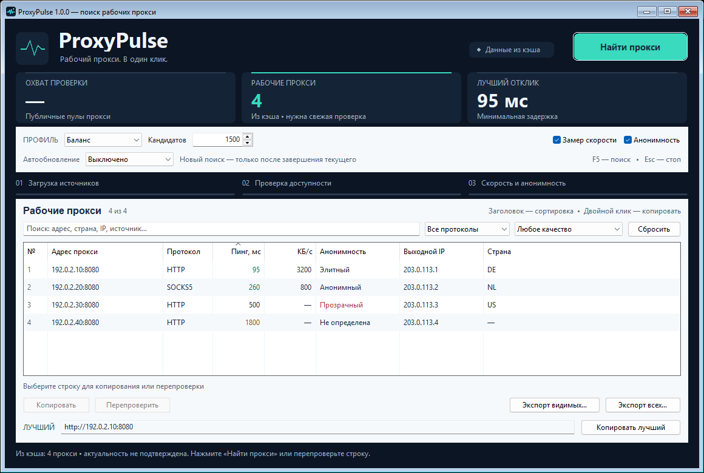

# ProxyPulse

**Рабочий прокси. В один клик.**

[Скачать для Windows](https://github.com/HVHBIGNAME/proxypulse/releases/latest) ·
[Что нового](CHANGELOG.md)

ProxyPulse скачивает публичные пулы прокси, параллельно проверяет каждую
кандидатуру, отбрасывает мёртвые, измеряет пинг/скорость/анонимность и
показывает лидерборд. Лучший прокси — в буфере обмена одним нажатием.

Нативный интерфейс с графитовой шапкой, бирюзовым пульсом, карточками состояния
и светлой таблицей. Поиск, фильтры и экспорт доступны прямо в рабочем окне.



*На снимке — демонстрационные адреса из диапазонов, зарезервированных для документации.*

## Что делает

- **Собирает** ~12 000 уникальных адресов из 23 пулов (HTTP и SOCKS5) параллельно, перемешивая их round-robin.
- **Замеряет** пинг, скорость скачивания (КБ/с) и класс анонимности (elite/anonymous/transparent).
- **Сортирует** по пингу и держит свежий результат; мёртвые не показываются.
- **Отдаёт результат**: двойной клик — прокси в буфере; экспорт — список `.txt` или `.json`.
- **Перепроверяет** выбранный прокси по запросу (пинг + актуальность).
- **Кэширует** результаты в компактном JSON, показывая их сразу при следующем запуске
  с пометкой о необходимости перепроверки.
- **Фильтрует** по протоколу, пингу и анонимности; ищет по адресу, стране, источнику и выходному IP.
- **Помогает настроить проверку**: быстрый, сбалансированный, глубокий и пользовательский профили.

## Установка

Скачайте **`ProxyPulse-1.0.0-windows-x64.zip`** из
[релиза](https://github.com/HVHBIGNAME/proxypulse/releases/latest), распакуйте
и откройте `proxypulse-gui.exe`. В ZIP также входит CLI `proxypulse.exe`.
Можно скачать GUI отдельным EXE. Установка не нужна; Windows 10/11 x64.

### Сборка из исходников

Нужен **Go 1.26.2+**. Для GUI дополнительно нужны **Python 3.11+**, Pillow и
`windres` из MinGW-w64 в `PATH`. Python и MinGW нужны только для сборки.

```bash
git clone https://github.com/HVHBIGNAME/proxypulse
cd proxypulse

# CLI-версия
go build -trimpath -ldflags "-s -w" -o proxypulse.exe ./cmd/proxypulse

# GUI + CLI + ZIP + SHA-256 (из PowerShell, cmd или Bash)
python -m pip install pillow==12.2.0
python scripts/build_release.py --version 1.0.0
```

Артефакты появятся в `dist/`. Например, для MinGW в `C:\mingw64` добавьте
`C:\mingw64\bin` в `PATH`. В Git Bash также доступен `./scripts/build-gui.sh`.
Манифест Common Controls и иконка автоматически встраиваются в EXE.

Проверки разработчика:

```powershell
go vet ./...
go test -race ./...
# После сборки ресурсов; открывает тестовое окно, использует локальные данные.
$env:PROXYPULSE_GUI_SMOKE = '1'
go test ./cmd/proxypulse-gui -run TestNativeDesktop -count=1 -timeout 60s
```

На Linux проверяйте переносимые пакеты:
`go test -race ./internal/... ./cmd/proxypulse`.

## Использование

### Графическое приложение (два клика)

1. Запустите `proxypulse-gui.exe`.
2. Выберите профиль и нажмите **Найти прокси** — пойдёт сбор и проверка.
3. Дождитесь строки «Готово» и нажмите **Копировать лучший** — рабочий прокси в буфере.
4. Вставляйте куда нужно (браузер, скрипт, клиент): `http://IP:PORT` или `socks5://IP:PORT`.

Двойной клик по строке копирует именно её. Кнопка **Перепроверить** проверяет
выбранную строку на актуальность. **Копировать лучший** всегда использует самый
быстрый результат из всего списка, независимо от фильтров.

| Профиль | Кандидатов | Скорость / анонимность |
|---------|------------|-----------------------|
| Быстрый | 500 | выключены |
| Баланс | 1500 | включены |
| Глубокий | 5000 | включены |
| Свой | 1–100 000 | настраиваются |

В GUI скорость измеряется для 60 лучших, анонимность — для 150 лучших.
Прочерк означает отсутствие успешного замера, а не нулевую скорость.
Кнопка остановки сохраняет уже полученные результаты. При ошибке загрузки
предыдущий список остаётся доступен.

**Клавиши:** `F5` — поиск, `Esc` — остановка, `Ctrl+F` — поиск по результатам,
`Ctrl+C` в таблице — выбранный прокси. Сортировка — по заголовкам колонок.
Можно экспортировать только видимые строки или весь список в TXT/JSON.
Анимации учитывают системную настройку Windows и не работают в простое.

### Командная строка

```bash
# Полный проход: собрать, проверить, показать топ-15, сохранить всё в файл
proxypulse.exe -limit 2000 -top 15 -out proxies.txt

# Только быстрые (>= 500 КБ/с), без проверки анонимности
proxypulse.exe -min-speed 500 -anon=false

# Список доступных пулов
proxypulse.exe -list-sources

# Перепроверить только то, что уже есть в кэше (с сетевой проверкой)
proxypulse.exe -db-only -top 20

# Версия сборки
proxypulse.exe -version
```

Ключевые флаги:

| Флаг | По умолчанию | Значение |
|------|--------------|----------|
| `-limit` | 0 (все) | сколько кандидатов проверять |
| `-workers` | 300 | одновременных проверок |
| `-timeout` | 4s | таймаут на прокси |
| `-top` | 10 | сколько строк показать |
| `-min-speed` | 0 | отсечь медленные (КБ/с) |
| `-speed` / `-anon` | true | замер скорости / анонимности |
| `-out` / `-json` | — | файл со списком / JSON |
| `-best` | — | вывести ТОЛЬКО один лучший прокси и выйти |
| `-format` | text | с `-best`: `text` или `json` |
| `-list-sources` | — | показать пулы и выйти |
| `-db-only` | false | перепроверить рабочие записи кэша, без загрузки пулов |
| `-version` | — | показать версию и выйти |

### Для скриптов и агентов

`-best` печатает ровно одну строку — готовый прокси — и ничего больше.
В этом режиме прогресс отключён, ошибки идут в stderr — stdout чист для захвата:

```bash
proxy=$(proxypulse -best -limit 800)          # http://IP:PORT или socks5://IP:PORT
curl -x "$proxy" https://api.ipify.org/       # сразу использовать
proxypulse -best -format json | jq -r .addr   # метаданные (пинг, скорость, анонимность)
proxypulse -db-only -best                      # перепроверить кэш и выбрать лучший
```

Результаты по умолчанию: `%LOCALAPPDATA%\ProxyPulse\` (`proxies.json`, `best.txt`).

## Источники

Официальные публичные списки прокси, только чтение:

| ID | Пул |
|----|-----|
| `monosans-http`, `monosans-socks5` | monosans/proxy-list |
| `thespeedx-http`, `thespeedx-socks5` | TheSpeedX/PROXY-List |
| `roosterkid-https`, `roosterkid-socks5` | roosterkid/openproxylist |
| `proxifly-http` | proxifly/free-proxy-list |
| `proxyscrape-http`, `proxyscrape-socks5` | ProxyScrape API |
| `geonode` | geonode.com API |
| `vakhov` | vakhov/fresh-proxy-list (JSON, per-protocol) |
| `murong-http`, `murong-socks5` | MuRongPIG/Proxy-Master |
| `hideipme-http`, `hideipme-socks5` | zloi-user/hideip.me (с гео) |
| `hookzof-socks5` | hookzof/socks5_list |
| `shifty-http`, `shifty-socks5` | ShiftyTR/Proxy-List |
| `clarketm` | clarketm/proxy-list |
| `aliilapro` | ALIILAPRO/Proxy |
| `anonwork-http` | anonym0uswork1221/free-proxies |
| `prxchk-http`, `prxchk-socks5` | prxchk/proxy-list |

Всего **23 пула**, ~12 000 уникальных адресов после дедупликации. Кандидаты
перемешиваются **round-robin** между пулами, а каждый пул отдаёт не больше
`DefaultCapPerSource` (1200) записей, равномерно распределённых по списку, —
поэтому гигантские зеркала (100k+ адресов) не вытесняют остальные пулы.

## Как это устроено

```
cmd/proxypulse        CLI
cmd/proxypulse-gui     Windows GUI (lxn/walk)
internal/sources       загрузка и разбор пулов
internal/proxy         проверка за прокси, пинг, скорость, анонимность
internal/app           конвейер: fetch → validate → enrich → sort
internal/store         JSON-кэш и экспорт
```

Вес Windows x64 release-сборки: **GUI ≈ 10,22 МиБ**, **CLI ≈ 6,22 МиБ**,
**ZIP с обоими приложениями ≈ 6,50 МиБ**. Размер может немного отличаться между
версиями Go. Сборка с `-trimpath -s -w`, без CGO и внешних сред выполнения.
Контрольные суммы — в `SHA256SUMS.txt` рядом с загрузками.

Прогресс объединяется перед передачей UI, сетевой параллелизм ограничен,
а отмена останавливает постановку новых задач. Неудачная перепроверка удаляет
прокси из рабочих записей кэша; отмена запроса сама по себе этого не делает.

Проверка живого прокси — реальный `GET https://api.ipify.org/` через прокси:
успех = ответ 200 и полученный адрес выхода. Анонимность определяется по
`httpbin.org/headers` (утечка реального IP = transparent).

## Ограничения

- Публичные бесплатные прокси **нестабильны**: их средний срок жизни — часы.
  Всегда перепроверяйте выбранный адрес перед использованием (`Перепроверить`).
- Бесплатный прокси не даёт гарантий приватности; не используйте для
  чувствительных данных.
- Инструмент только читает публичные списки и проверяет доступность. Он не
  обходит платные квоты и не создаёт аккаунты.

## Лицензия

MIT — см. [LICENSE](LICENSE).
